<!-- Paul Sattaur / PStar80 | Repository-local blue metallic profile. -->
<!-- Animated assets are in assets/profile; still-image fallbacks are in assets/static; daily activity is on output. -->

<picture>
  <source media="(prefers-reduced-motion: reduce) and (max-width: 650px)" srcset="./assets/static/hero-mobile.svg" />
  <source media="(prefers-reduced-motion: reduce)" srcset="./assets/static/hero.svg" />
  <source media="(max-width: 650px)" srcset="./assets/profile/hero-mobile.svg" />
  
</picture>

<picture>
  <source media="(prefers-reduced-motion: reduce) and (max-width: 650px)" srcset="./assets/static/overview-mobile.svg" />
  <source media="(prefers-reduced-motion: reduce)" srcset="./assets/static/overview.svg" />
  <source media="(max-width: 650px)" srcset="./assets/profile/overview-mobile.svg" />
  
</picture>

<picture>
  <source media="(prefers-reduced-motion: reduce) and (max-width: 650px)" srcset="./assets/static/systems-mobile.svg" />
  <source media="(prefers-reduced-motion: reduce)" srcset="./assets/static/systems.svg" />
  <source media="(max-width: 650px)" srcset="./assets/profile/systems-mobile.svg" />
  
</picture>

  <a href="https://github.com/PStar80/SkyCommand-Demo/blob/main/docs/architecture.md"><strong>MCP, agent capabilities &amp; work-order architecture</strong></a>

<picture>
  <source media="(prefers-reduced-motion: reduce) and (max-width: 650px)" srcset="./assets/static/projects-mobile.svg" />
  <source media="(prefers-reduced-motion: reduce)" srcset="./assets/static/projects.svg" />
  <source media="(max-width: 650px)" srcset="./assets/profile/projects-mobile.svg" />
  
</picture>

  <a href="https://github.com/PStar80/SkyCommand-Demo"><strong>Explore SkyCommand</strong></a> ·
  <a href="mailto:paulsattaur@hotmail.com?subject=SkyCommand%20walkthrough"><strong>Request a walkthrough</strong></a>

<picture>
  <source media="(prefers-reduced-motion: reduce) and (max-width: 650px)" srcset="./assets/static/portfolio-mobile.svg" />
  <source media="(prefers-reduced-motion: reduce)" srcset="./assets/static/portfolio.svg" />
  <source media="(max-width: 650px)" srcset="./assets/profile/portfolio-mobile.svg" />
  
</picture>

  <a href="https://github.com/PStar80/SkyDataStudio"><strong>SkyDataStudio source</strong></a> ·
  <a href="https://github.com/PStar80/MacroAnalyzer"><strong>MacroAnalyzer source</strong></a>

<picture>
  <source media="(prefers-reduced-motion: reduce) and (max-width: 650px)" srcset="https://raw.githubusercontent.com/PStar80/PStar80/output/engineering-activity-mobile-static.svg" />
  <source media="(prefers-reduced-motion: reduce)" srcset="https://raw.githubusercontent.com/PStar80/PStar80/output/engineering-activity-static.svg" />
  <source media="(max-width: 650px)" srcset="https://raw.githubusercontent.com/PStar80/PStar80/output/engineering-activity-mobile.svg" />
  
</picture>

<picture>
  <source media="(prefers-reduced-motion: reduce) and (max-width: 650px)" srcset="./assets/static/connect-mobile.svg" />
  <source media="(prefers-reduced-motion: reduce)" srcset="./assets/static/connect.svg" />
  <source media="(max-width: 650px)" srcset="./assets/profile/connect-mobile.svg" />
  
</picture>

  <a href="https://www.linkedin.com/in/paulsattaur/"><picture><source media="(prefers-reduced-motion: reduce) and (max-width: 650px)" srcset="./assets/static/linkedin-mobile.svg" /><source media="(prefers-reduced-motion: reduce)" srcset="./assets/static/linkedin.svg" /><source media="(max-width: 650px)" srcset="./assets/profile/linkedin-mobile.svg" /></picture></a>
  <a href="https://github.com/PStar80"><picture><source media="(prefers-reduced-motion: reduce) and (max-width: 650px)" srcset="./assets/static/github-mobile.svg" /><source media="(prefers-reduced-motion: reduce)" srcset="./assets/static/github.svg" /><source media="(max-width: 650px)" srcset="./assets/profile/github-mobile.svg" /></picture></a>
  <a href="mailto:paulsattaur@hotmail.com"><picture><source media="(prefers-reduced-motion: reduce) and (max-width: 650px)" srcset="./assets/static/email-mobile.svg" /><source media="(prefers-reduced-motion: reduce)" srcset="./assets/static/email.svg" /><source media="(max-width: 650px)" srcset="./assets/profile/email-mobile.svg" /></picture></a>

<strong>Profile details — readable text, projects and engineering principles</strong>

### About me

I'm **Paul Sattaur**, a full-stack software engineer based in the Greater Toronto Area, Canada. I design and build applications with scalability, maintainability and a clear user experience in mind, connecting interactive interfaces, APIs, databases, data pipelines and containerized services.

My work spans three connected areas: **workflow automation with SkyCommand**, **data engineering with SkyDataStudio**, and **interactive analytics and data visualization with MacroAnalyzer**. Together, these applications bring operational workflows, trusted analytical data and user-facing insights into a connected ecosystem.

I work across **React, JavaScript/TypeScript, Node.js, Python/FastAPI, C#/ASP.NET Core and PostgreSQL**, with **Temporal** for workflow orchestration, **Airflow and dbt** for data engineering, **ECharts/D3** for visualization, and **Docker** for containerized services. My enterprise background also includes Oracle SQL/PLSQL, Java/J2EE, requirements analysis, integrations and production troubleshooting.

My current focus is **AI-native applications and agentic automation**: integrating embedded AI agents and MCP-connected coding assistants with application workflows, configured capabilities and observable execution. I build across the stack, from the user experience through to the services and data that power it.

### Selected work

**[SkyCommand — independent platform, private source](https://github.com/PStar80/SkyCommand-Demo)**

A workflow automation and orchestration platform with Temporal-backed durable execution, reusable tools, optional AI-agent nodes, approvals, retries, recovery controls, scheduling, structured results and operational visibility. My current work includes external coding-agent access through MCP, configurable embedded-agent capabilities, and developer workflows across Git, Docker and database-backed services.

**Architecture at a glance:** operators and external coding agents can each use the React UI or access the Node.js Core API. The diagram groups those entry points as **React UI / Node.js Core API**, branching to **Registered Tools**, **Embedded AI Agents** and **Published Workflows**. All three service paths connect to **PostgreSQL Database** for data and persisted state.

**Agents in both directions:** workflows can call embedded agents, and external coding assistants can use SkyCommand through MCP to invoke exposed registered operations and inspect results. External and embedded connections use distinct identities and permissions over shared platform registrations.

**Embedded-agent capability controls:** assignments are scoped to a Project and exact Agent definition version, covering Tools, published Workflows and supported direct operations. Direct-operation controls do not add duplicate checks inside an already enabled Tool or Workflow's normal contract. Existing executor permissions and explicitly configured approvals still apply.

**Structured prompt and work-order engineering:** I use work-order families to coordinate scoped development streams, assigned roles, dependencies, exact handoffs, execution state and review evidence. One accountable writer per shared checkout preserves unrelated work. **Phase 20 is planned to integrate this existing development method into SkyCommand natively; that product integration is not yet presented as delivered.**

Explore the [public showcase](https://github.com/PStar80/SkyCommand-Demo) for the MCP and capability architecture, work-order model, feature tour, and walkthrough guide. The application implementation remains private. [Ask about SkyCommand](mailto:paulsattaur@hotmail.com?subject=SkyCommand%20walkthrough).

**[MacroAnalyzer — public repository](https://github.com/PStar80/MacroAnalyzer)**

A full-stack macroeconomic analytics project built with React, ASP.NET Core/C#, PostgreSQL and REST APIs, with dashboards, time-series views, alerting and ECharts/D3 visualizations.

**[SkyDataStudio — public repository](https://github.com/PStar80/SkyDataStudio)**

Data engineering workbench for governed analytical products, with metadata, pipelines, dbt transformations, data quality and lineage. It prepares trusted ingested data for analytical consumption, using Python/FastAPI, PostgreSQL, Airflow, dbt and Docker.

### Engineering principles

- Clear contracts over hidden assumptions.
- Deterministic execution by default; agents where useful.
- Observable systems and structured results over silent failure.
- Recoverability, repeatable validation and human review.
- Measure performance before optimizing it.

### Activity data

The blue calendar is generated daily by this repository's GitHub Actions workflow from GitHub's contribution-calendar API. It displays aggregate daily counts, not repository names or commit details. Counts are limited to what GitHub returns to the built-in Actions token and can differ from the native profile calendar because of visibility, date ranges and update timing. The last successful update is printed on the card; a failed refresh leaves the previously published version intact.

Header and architecture animations are illustrations, not live operational telemetry. Reduced-motion settings select still-image versions of every panel, including the calendar and contact buttons.

### Contact

[LinkedIn](https://www.linkedin.com/in/paulsattaur/) · [GitHub](https://github.com/PStar80) · [Email](mailto:paulsattaur@hotmail.com)

Open to conversations about backend development, workflow automation, data engineering, AI-enabled software and consulting.

