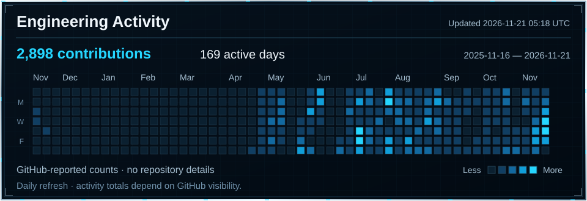

<!-- Paul Sattaur / PStar80 | Repository-local blue metallic profile. -->
<!-- Static-design assets live beside this README. Daily activity assets are published to output. -->

<picture>
  <source media="(max-width: 650px)" srcset="./hero-mobile.svg" />
  
</picture>

<picture>
  <source media="(max-width: 650px)" srcset="./overview-mobile.svg" />
  
</picture>

<picture>
  <source media="(max-width: 650px)" srcset="./systems-mobile.svg" />
  
</picture>

<picture>
  <source media="(max-width: 650px)" srcset="./projects-mobile.svg" />
  
</picture>

  <a href="https://github.com/PStar80/MacroAnalyzer"><strong>MacroAnalyzer source</strong></a> ·
  <a href="mailto:paulsattaur@hotmail.com?subject=SkyCommand%20walkthrough"><strong>Ask about a SkyCommand walkthrough</strong></a>

<picture>
  <source media="(max-width: 650px)" srcset="https://raw.githubusercontent.com/PStar80/PStar80/output/engineering-activity-mobile.svg" />
  
</picture>

<picture>
  <source media="(max-width: 650px)" srcset="./connect-mobile.svg" />
  
</picture>

  <a href="https://www.linkedin.com/in/paulsattaur/"><picture><source media="(max-width: 650px)" srcset="./linkedin-mobile.svg" /></picture></a>
  <a href="https://github.com/PStar80"><picture><source media="(max-width: 650px)" srcset="./github-mobile.svg" /></picture></a>
  <a href="mailto:paulsattaur@hotmail.com"><picture><source media="(max-width: 650px)" srcset="./email-mobile.svg" /></picture></a>

<strong>Profile details — readable text, projects and engineering principles</strong>

### About me

I'm **Paul Sattaur**, a software engineer based in the Greater Toronto Area, Canada. I build backend systems, deterministic workflow automation, data platforms and operational software where execution is observable and recoverable.

My enterprise background includes **Oracle SQL/PLSQL, Java/J2EE, C#/.NET components, requirements analysis, integrations and production troubleshooting**. My independent development work extends that foundation with **Node.js, TypeScript, React, PostgreSQL, ASP.NET Core, Python, Docker and Temporal**.

**Deterministic workflows are my default. AI agents are optional tools for work that benefits from adaptive reasoning—not a replacement for engineering judgment, testing or clear execution boundaries.**

### Selected work

**SkyCommand — independent platform, private source**

A workflow automation and orchestration platform with Temporal-backed durable execution, reusable tools, optional AI-agent nodes, approvals, retries, recovery controls, scheduling, structured results and operational visibility. My current work includes agent integration and developer workflows across Git, Docker and database-backed services.

The implementation remains private. I welcome conversations about its architecture and demonstrations; a separate public showcase is planned. [Ask about SkyCommand](mailto:paulsattaur@hotmail.com?subject=SkyCommand%20walkthrough).

**[MacroAnalyzer — public repository](https://github.com/PStar80/MacroAnalyzer)**

A full-stack macroeconomic analytics project built with React, ASP.NET Core/C#, PostgreSQL and REST APIs, with dashboards, time-series views, alerting and ECharts/D3 visualizations.

**[SkyDataStudio — public repository](https://github.com/PStar80/SkyDataStudio)**

An additional public project in my development ecosystem. The repository is the source of truth for its current scope and implementation.

### Engineering principles

- Clear contracts over hidden assumptions.
- Deterministic execution by default; agents where useful.
- Observable systems and structured results over silent failure.
- Recoverability, repeatable validation and human review.
- Measure performance before optimizing it.

### Activity data

The blue calendar is generated daily by this repository's GitHub Actions workflow from GitHub's contribution-calendar API. It displays aggregate daily counts, not repository names or commit details. Counts are limited to what GitHub returns to the built-in Actions token and can differ from the native profile calendar because of visibility, date ranges and update timing. The last successful update is printed on the card; a failed refresh leaves the previously published version intact.

Header and architecture animations are illustrations, not live operational telemetry. Motion stops when the viewer's browser honours the reduced-motion preference.

### Contact

[LinkedIn](https://www.linkedin.com/in/paulsattaur/) · [GitHub](https://github.com/PStar80) · [Email](mailto:paulsattaur@hotmail.com)

Open to conversations about backend development, workflow automation, data engineering, AI-enabled software and consulting.

