<!-- Paul Sattaur / PStar80 | Repository-local blue metallic profile. -->
<!-- All visual assets live in assets/profile. No external render service required. -->

<picture>
  <source media="(max-width: 650px)" srcset="./assets/profile/hero-mobile.svg" />
  
</picture>

  <a href="https://github.com/PStar80/MacroAnalyzer">Explore MacroAnalyzer</a> ·
  <a href="mailto:paulsattaur@hotmail.com?subject=SkyCommand%20walkthrough">Ask about SkyCommand</a> ·
  <a href="https://www.linkedin.com/in/paulsattaur/">Connect on LinkedIn</a>

<picture>
  <source media="(max-width: 650px)" srcset="./assets/profile/overview-mobile.svg" />
  
</picture>

<picture>
  <source media="(max-width: 650px)" srcset="./assets/profile/systems-mobile.svg" />
  
</picture>

<picture>
  <source media="(max-width: 650px)" srcset="./assets/profile/projects-mobile.svg" />
  
</picture>

  <a href="https://github.com/PStar80/MacroAnalyzer"><strong>MacroAnalyzer — public source ↗</strong></a> ·
  <a href="mailto:paulsattaur@hotmail.com?subject=SkyCommand%20walkthrough"><strong>SkyCommand — discuss a walkthrough ↗</strong></a>

<picture>
  <source media="(max-width: 650px)" srcset="./assets/profile/connect-mobile.svg" />
  
</picture>

  <a href="https://www.linkedin.com/in/paulsattaur/"><picture><source media="(max-width: 650px)" srcset="./assets/profile/linkedin-mobile.svg" /></picture></a>
  <a href="https://github.com/PStar80"><picture><source media="(max-width: 650px)" srcset="./assets/profile/github-mobile.svg" /></picture></a>
  <a href="mailto:paulsattaur@hotmail.com"><picture><source media="(max-width: 650px)" srcset="./assets/profile/email-mobile.svg" /></picture></a>

<strong>Profile details — readable text, projects and engineering principles</strong>

### About me

I'm **Paul Sattaur**, a software engineer based in the Greater Toronto Area, Canada. I build backend systems, deterministic workflow automation, data platforms and operational software where execution is observable and recoverable.

My enterprise background includes **Oracle SQL/PLSQL, Java/J2EE, C#/.NET components, requirements analysis, integrations and production troubleshooting**. My independent development work extends that foundation with **Node.js, TypeScript, React, PostgreSQL, ASP.NET Core, Python, Docker and Temporal**.

**Deterministic workflows are my default. AI agents are optional tools for work that benefits from adaptive reasoning—not a replacement for engineering judgment, testing or clear execution boundaries.**

### Selected work

**SkyCommand — independent platform, private source**

A workflow automation and orchestration platform with Temporal-backed durable execution, reusable tools, optional AI-agent nodes, approvals, retries, recovery controls, scheduling, structured results and operational visibility. My current work includes agent integration and developer workflows across Git, Docker and database-backed services.

The implementation remains private. I welcome conversations about its architecture and demonstrations; a separate public showcase is planned. [Ask about SkyCommand](mailto:paulsattaur@hotmail.com?subject=SkyCommand%20walkthrough).

**[MacroAnalyzer — public repository](https://github.com/PStar80/MacroAnalyzer)**

A full-stack macroeconomic analytics project built with React, ASP.NET Core/C#, PostgreSQL and REST APIs, with dashboards, time-series views, alerting and ECharts/D3 visualizations.

**[SkyDataStudio — public repository](https://github.com/PStar80/SkyDataStudio)**

An additional public project in my development ecosystem. The repository is the source of truth for its current scope and implementation.

### Engineering principles

- Clear contracts over hidden assumptions.
- Deterministic execution by default; agents where useful.
- Observable systems and structured results over silent failure.
- Recoverability, repeatable validation and human review.
- Measure performance before optimizing it.

### Contact

[LinkedIn](https://www.linkedin.com/in/paulsattaur/) · [GitHub](https://github.com/PStar80) · [Email](mailto:paulsattaur@hotmail.com)

Open to conversations about backend development, workflow automation, data engineering, AI-enabled software and consulting.

